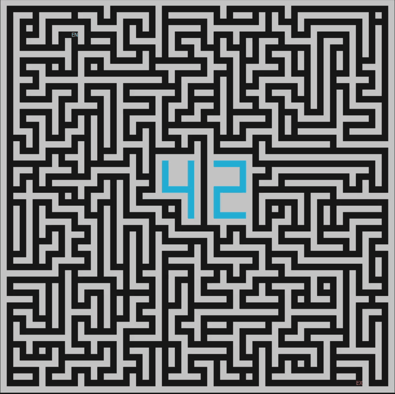
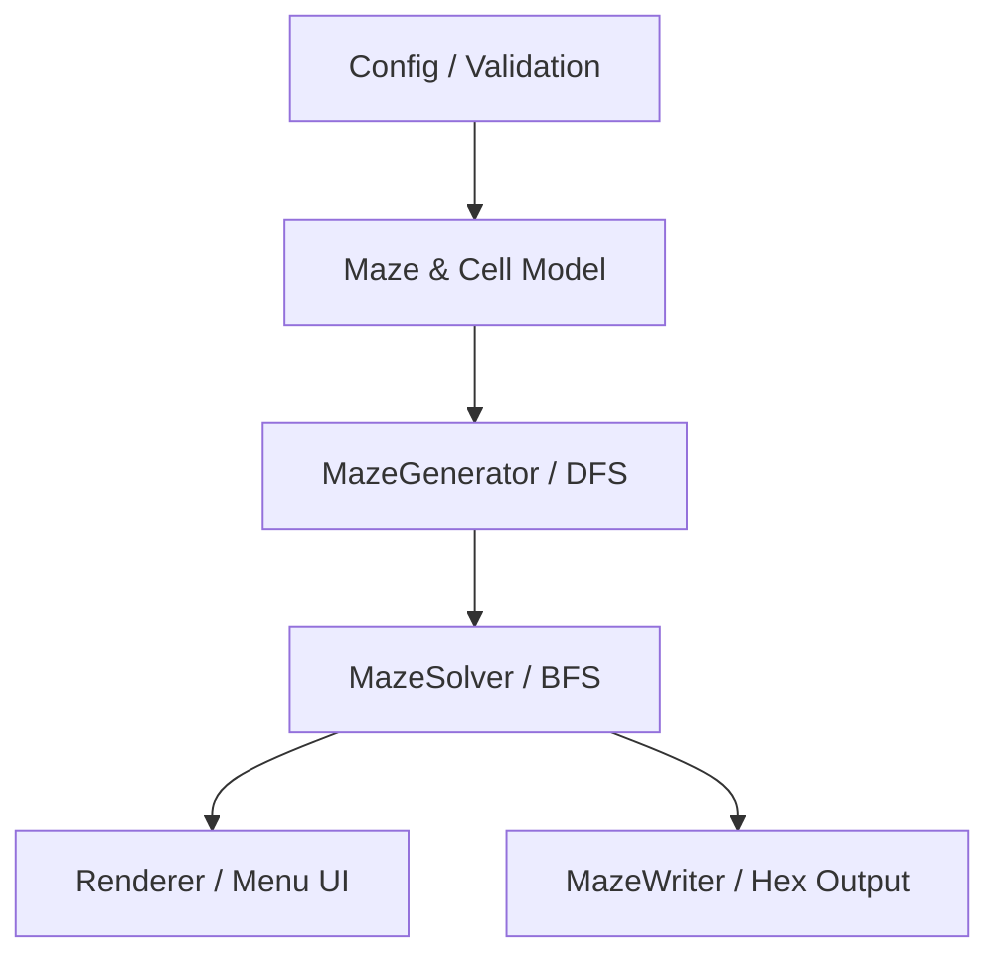

*This project has been created as part of the 42 curriculum by stehoffm and archowdh.*

# A-Maze-ing

A configurable Python maze generator, solver, and terminal visualizer developed at Codam (42 Network).

The project represents mazes as **grid graphs**, using randomized depth-first search (DFS) for generation and breadth-first search (BFS) for shortest-path solving.

<p align="center">
  
</p>

The demonstration shows the shortest route from entry (`EN`) to exit (`EX`) around the protected `42` pattern.

## Highlights

- **Two generation modes:** Perfect mazes and braided, Pac-Man-like playable boards.
- **Graph algorithms:** Randomized DFS generation, BFS solving, and graph-property validation.
- **Configurable:** Maze dimensions, entry/exit positions, random seeds, patterns, and terminal colours.
- **Interactive visualization:** ANSI terminal rendering with animated path solving.
- **Reusable Python package:** `mazegen`, with automated tests, type checking, and linting.

## How It Works

The generator starts with a spanning tree produced by randomized DFS. In playable mode, additional passages are opened while preserving maze constraints.

| Property | Perfect maze | Playable board |
|---|---|---|
| Connectivity | Connected | Connected |
| Independent cycles | 0 | At least 2 |
| Dead ends | Allowed | None |
| Paths | Unique between cells | Multiple possible routes |

**Core algorithms**

- **DFS:** Generates a connected maze by carving passages between unvisited cells.
- **Graph post-processing:** Introduces cycles, eliminates dead ends, and rejects oversized open rooms.
- **BFS:** Finds a shortest route between the entry and exit.
- **Protected patterns:** Keeps the central `42` structure intact during generation.

The generator validates connectivity and the required structural constraints after generation.

## Quick Start

**Requirements:** Python 3.10+, `pip`, and `make`.

Install development dependencies and start the application:

```bash
make install
make run
```

Alternatively, execute it with a configuration file:

```bash
python3 a_maze_ing.py config.txt
```

Additional commands:

```bash
make test       # Run pytest
make lint       # Run flake8 and mypy
make package    # Build the Python distribution
make debug      # Run with pdb
make clean      # Remove generated build files
```

## Architecture

The project separates maze state, generation, solving, rendering, and serialization.



| Component | Responsibility |
|---|---|
| `Maze`, `Cell`, `Position`, `Direction` | Grid representation, walls, and coordinates |
| `MazeGenerator` | Maze generation and graph post-processing |
| `MazeSolver` | BFS and shortest-path reconstruction |
| `Config` | Input parsing and validation |
| `Renderer`, `MenuUI` | Interactive terminal visualization |
| `MazeWriter` | Hexadecimal maze serialization |

The application can also be installed as the `mazegen` package, exposing the `maze-gen` command.

## Configuration

Configuration uses `KEY=VALUE` pairs in `config.txt`.

```ini
WIDTH=30
HEIGHT=30
ENTRY=5,3
EXIT=29,25
OUTPUT_FILE=maze.txt
PERFECT=False
PATTERN=42
SEED=42
```

Optional settings include `WALL_COLOR`, `PATH_COLOR`, and `PATTERN_COLOR`.

Setting `PERFECT=True` creates a perfect maze. Setting `SEED` allows reproducible generation.

The parser validates dimensions, coordinates, configuration values, and impossible layouts before generation.

## Output Format

Each maze cell is serialized as a hexadecimal digit encoding its four walls.

| Wall | Bit value |
|---|---|
| North | `1` |
| East | `2` |
| South | `4` |
| West | `8` |

The output also contains entry and exit coordinates and the shortest route encoded as `N`, `E`, `S`, and `W`.

The generated file can be validated with:

```bash
python3 tools/maze_analyzer.py maze.txt
```

## Testing

Automated tests cover:

- **Graph invariants:** Connectivity, cycle counts, and dead-end elimination.
- **Maze model:** Shared walls, boundaries, and protected cells.
- **Configuration:** Valid inputs and error handling.
- **Output:** Hexadecimal encoding and path serialization.
- **Subject constraints:** Playable layouts, protected patterns, and reproducibility.

The project uses `pytest` for testing, `mypy` for static type checking, and `flake8` for linting.

## Team & Contributions

Developed collaboratively by **stehoffm010** and **Arunima1005**.

| Contributor | Primary responsibilities |
|---|---|
| **stehoffm010** — [GitHub](https://github.com/shoffman010) | Configuration parsing and validation, terminal rendering, protected patterns, playable-board generation, graph post-processing, packaging, and development tooling |
| **Arunima1005** — [GitHub](https://github.com/Arunima1005) | Grid initialization, randomized DFS generation, BFS solver, interactive menu, solution animation, and alternative locked-cell patterns |

**Shared responsibilities:** Initial `Cell` model, architectural decisions, migration from subject v2.0 to v2.2, playable-board constraints, analyser integration, and final testing.

Contributions are also recorded in the repository's Git history.

## Resources

- [Python documentation](https://docs.python.org/3/)
- [Depth-first search](https://en.wikipedia.org/wiki/Depth-first_search)
- [Breadth-first search](https://en.wikipedia.org/wiki/Breadth-first_search)
- [Python Packaging User Guide](https://packaging.python.org/)

### AI Usage

The original v2.0 implementation was developed without AI-generated implementation code.

During the v2.2 migration, AI assisted with candidate implementations for selected changes, documentation, docstrings, conceptual explanations, and parts of the test suite.

Generated suggestions were reviewed, adapted, and tested by the developers before integration.

## Future Improvements

Potential improvements include replacing recursive DFS with an explicit stack for large mazes, adding CI checks, and expanding performance and installation testing.